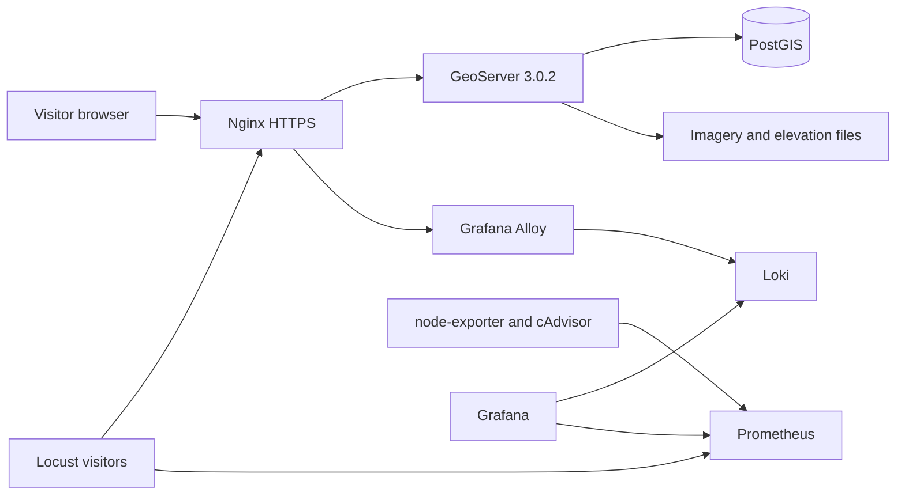

# How the server is put together

GeoKnight GIS is one Docker Compose stack. The same file runs on a Windows laptop (Docker Desktop with WSL2, repository under `C:\dev`) and on an Ubuntu 24.04 virtual machine. What changes between those two places is the TLS certificate, not the services.



## What each part does

| Part | Role |
| --- | --- |
| Nginx | The only public door. It redirects HTTP to HTTPS, adds security headers, and writes a JSON line for every request. The admin pages and the dashboard are limited to approved networks. |
| GeoServer 3.0.2 | Serves WMS, WFS, WMTS, and WCS from the official `docker.osgeo.org/geoserver:3.0.2` image. |
| PostGIS 16 / 3.5 | Holds roads, tracts, parcels, MIRTA points, the area-of-interest outline, and editor notes. |
| Imagery and elevation | Cloud Optimized GeoTIFFs on disk. GeoServer reads them. They are not loaded into the database. |
| Prometheus, node-exporter, cAdvisor | Host CPU, memory, disk, and container stats. |
| Loki and Grafana Alloy | Alloy tails the Nginx JSON log and stores it in Loki. Promtail is not used. |
| Grafana | The GeoKnight dashboard. Colors are navy `#0b1f3a` and gold `#c9a227`. |
| Locust | Optional. It pretends to be a public visitor, an analyst, an editor, and an intruder. |

## Workspaces

The **public** workspace holds roads, census tracts, the area-of-interest outline, NAIP imagery, the elevation grid, and the hillshade.

The **restricted** workspace holds parcels, MIRTA installation points, and editor notes. A visitor who is not signed in with an analyst or editor account is challenged (HTTP 401). A signed-in viewer who lacks those roles is refused (HTTP 403).

## Data folder

The loader expects this layout and does not commit the files:

```
data/aoi.geojson
data/aoi_26917.geojson
data/vector/gpkg/{parcels,roads,mirta_fl,tracts}.gpkg
data/vector/sql/{parcels,roads,mirta_fl,tracts}.sql
data/imagery/naip_2025_jax_aoi_cog.tif
data/elevation/dem_3dep_aoi_cog.tif
data/elevation/hillshade_aoi_cog.tif
data/styles/dem_colorramp.sld
data/styles/hillshade.sld
```

The SQL files are ogr2ogr PGDump scripts in EPSG:26917 with GiST indexes. When a SQL file is present it is loaded. Otherwise the matching GeoPackage is loaded. The parcel key is `RE`. The MIRTA site name is `SITENAME`. Owner names are not in the parcel table.

The area of interest is EPSG:26917 X 429240–438990, Y 3341670–3358380, about longitude -81.736 to -81.634 and latitude 30.204 to 30.356.

## Request path

1. The browser opens `https://<host>/`.
2. Nginx terminates TLS and proxies `/geoserver/` to GeoServer.
3. GeoServer reads vectors from PostGIS and rasters from `/opt/data`.
4. Tile requests that repeat the same WMTS tile are answered by GeoWebCache. Nginx records `HIT` or `MISS`.
5. Alloy ships the JSON access line to Loki. Grafana draws it.

## Local versus the cloud VM

| | Laptop | Ubuntu VM |
| --- | --- | --- |
| TLS | `make tls` builds a local certificate | `scripts/tls-certbot.sh` requests Let's Encrypt |
| Firewall | Docker Desktop's own network | `scripts/harden-vm.sh` turns on ufw and fail2ban |
| Keycloak | Profile `oidc`, off unless you start it | Same |

GeoServer is published only on `127.0.0.1:8080`. PostGIS is published only on `127.0.0.1:5432`. The public ports are 80 and 443.
